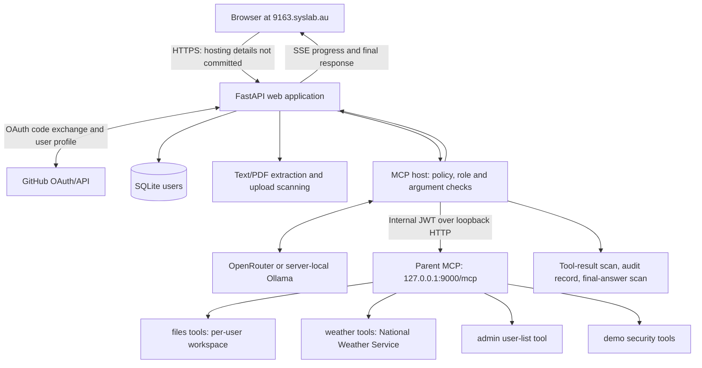

# Secure AI MCP Web Server — Public Domain Version

[domain_mcp](https://github.com/LiBingze33/ICP-Project1/tree/domain_mcp) is the publicly deployed version of this university security-focused MCP prototype. The supplied deployment address is **[https://9163.syslab.au](https://9163.syslab.au)**. This documentation describes the committed implementation; it does not establish that the service is currently online.

The project demonstrates controlled interaction between an AI model, local files, external weather APIs, and MCP tools. Authentication, tool policies, pre-call validation, post-call scanning, and audit records provide material for security demonstrations and the university project report.

## Application architecture



The browser submits multipart forms to `/chat-stream`. FastAPI checks the signed session and reloads the user's database record before constructing trusted identity, role, and workspace context. The host selects a request category and MCP prompt, exposes only its allowed tools, executes validated calls, scans tool results, and checks the final model answer. The MCP children are mounted namespaces in one parent server process, not independent network services.

## Public deployment and authentication

`main.py` explicitly sets the OAuth redirect URI to `https://9163.syslab.au/auth/callback`. `/auth/callback` exchanges the GitHub authorisation code, retrieves the GitHub profile, creates or loads the SQLite user, establishes their workspace, and stores identity in the signed session. New users receive role `user`; there is no admin registration or role-editing interface. Logout clears the application session, not the user's GitHub login.

The session cookie uses `Secure`, `SameSite=Lax`, and a two-hour lifetime. `make web` starts Uvicorn on `0.0.0.0:8000` with development reload. The MCP process binds only `127.0.0.1:9000`; the host's MCP URL is fixed to the same loopback address.

**Hosting configuration is not included.** There are no Nginx/Caddy files, TLS certificate settings, DNS records, Docker manifests, systemd units, or deployment automation. The repository therefore does not identify the actual reverse proxy, TLS terminator, hosting provider, or process supervisor. The public HTTPS address and callback are known, while their infrastructure cannot be reconstructed from this branch alone.

## Implemented features

- GitHub OAuth login, signed sessions, SQLAlchemy/SQLite users, and per-user workspace folders.
- Category-specific tool allowlists for files, weather, admin, demo, and general conversation. General conversation has no tools.
- File list/read/create/delete operations, with host-supplied workspace arguments and a browser consent/resubmission flow for deletion.
- US weather alerts and location forecasts from `api.weather.gov`.
- Admin user listing filtered by the host according to the database role.
- Browser selection of OpenRouter or Ollama; model progress logs and final replies are delivered with SSE, not individual streamed model tokens.
- UTF-8 text/Markdown and PDF summarisation, plus image descriptions for `.png`, `.jpg`, and `.jpeg` using a vision-capable backend. PDF extraction is limited to 20,000 characters.
- Six synthetic security tools: `demo_safe_health_check`, `demo_safe_public_info`, `demo_safe_echo`, `demo_fake_secret_api`, `demo_fake_desktop_info_api`, and `demo_fake_error_status_api`.

The demo tools simulate suspicious output without reading real secrets or Desktop files. The registered `weather_only_tool` is not exposed by the host policies. `weather_get_user_info` expects a FastMCP access-token context that the custom JWT middleware does not establish; its successful identity lookup is not verified.

## Security controls and limits

| Layer | Connected implementation |
| --- | --- |
| User context | Chat requires a session and a database user; role/workspace are reloaded from SQLite |
| Tool selection | Host category allowlists, admin filtering, argument validation, and trusted workspace injection |
| Consent | A delete action key identifies the filename; the browser asks before resubmitting an approved operation |
| Service authentication | HS256 internal JWT, 60-second expiry, issuer `fastapi-web`, audience `mcp-server` |
| MCP limits | Five requests/second, burst ten, response limit 100,000 bytes |
| Input | Active XSS/SQL-like pattern checks in host/upload paths; file tools reject separators and parent-traversal filename forms |
| Output | Secret/prompt-injection/XSS/API-error/Desktop-leak patterns; URL/HTML canonicalisation and local-path redaction |
| Audit | JSON-lines tool decisions with identity, role, duration, output size and reason; selected secret/content/workspace keys are redacted |

`PreCheckMiddleware` defines additional sensitive-file, permission, read-output, and `confirm=True` checks, but the class is not attached to either MCP server. Only its explicitly called text helper is active. Internal JWT middleware authenticates the backend service; it does not independently enforce the host's per-tool role policy.

The post-call checker scans tool output before it is passed back to the model and scans the final answer before display. Upload text/PDF content is scanned before model submission; image content is not OCR-scanned first. Audit logging is triggered by MCP tool execution, not by a general assessment of whether every external API is safe.

## Differences from the local version

| Topic | `local_mcp` | `domain_mcp` |
| --- | --- | --- |
| Intended access | Developer-hosted browser session | Public HTTPS address above |
| OAuth callback | Derived from incoming request URL | Fixed to the public domain callback |
| Secure session cookie | Enabled | Enabled; not an additional public-only feature |
| Web/MCP defaults | Uvicorn :8000 and loopback MCP :9000 | Same defaults |
| Data/model/security workflow | OAuth, SQLite, allowlists, JWTs, uploads, post-call checks | Same functional workflow |
| Deployment infrastructure | Not committed | Also not committed |
| Other repository differences | More explanatory source comments; tracked local runtime data | Different comments/line endings and tracked runtime data; a secrets demonstration path |

Source inspection found no additional public-only security subsystem. The audit module also differs by a postponed-annotations import; most remaining Python differences are comments and formatting. Runtime database/workspace contents differ and are not configuration templates.

## Project structure

```text
.gitignore
README.md
web_server/
  Makefile
  main.py                          # Fixed public OAuth callback, sessions, SSE
  main_mcp.py                      # Parent MCP and middleware
  database/
    db.py                          # sqlite:///./database.db
    model.py                       # User record
  mcp_servers/
    admin_server.py
    demo_security_server.py
    local_file_server.py
    weather_http_server.py
    secrets/                       # Existing demonstration path, not credentials setup
  middleware/
    __init__.py
    internal_jwt.py
    pre_check.py
    response_check.py
  pages/home.html
  security/post_call_audit.py
  services/
    mcp_host.py
    upload_processing.py
  database.db                      # Existing tracked runtime database
  user_workspaces/                  # Existing tracked user content
```

There is no `tests/` directory in this branch. The older README's `tests.test_postcall_security`, `tests.test_upload_processing`, and `tests.test_post_call_audit` commands do not correspond to committed files and are not valid verification instructions for this snapshot.

## Installation and deployment prerequisites

Use Python 3.10+ for the source syntax, pip/venv, and Make. Dependencies are unpinned. The existing Makefile installs FastAPI, Uvicorn, Jinja2, Pydantic, python-dotenv, OpenAI, FastMCP, HTTPX, SQLAlchemy, Authlib, itsdangerous, PyJWT, pypdf, and python-multipart. PDF extraction falls back to PyPDF2 if separately available.

```bash
git clone --branch domain_mcp https://github.com/LiBingze33/ICP-Project1.git
cd ICP-Project1/web_server
make install
```

Supply credentials privately through the process environment or an untracked `web_server/.env`:

| Variable | Purpose/default |
| --- | --- |
| `GITHUB_CLIENT_ID`, `GITHUB_CLIENT_SECRET` | GitHub OAuth app registered for `https://9163.syslab.au/auth/callback` |
| `SESSION_SECRET_KEY` | Strong private cookie-signing key |
| `INTERNAL_JWT_SECRET` | Strong shared private key for web and MCP processes |
| `OPENROUTER_API_KEY` | Required when the client is created, even if Ollama is later selected |
| `OPENROUTER_MODEL` | Optional; `anthropic/claude-sonnet-4.5` |
| `OLLAMA_BASE_URL` | Optional; `http://127.0.0.1:11434/v1` on the deployment host |
| `OLLAMA_MODEL` | Optional; `llama3.2` |

`make session-key` generates a random value locally; use separate private session/JWT keys. Run both processes from `web_server`, since database, templates, and workspaces use relative paths:

```bash
make mcp
```

```bash
# In a second terminal in web_server:
make web
```

These are the repository's development startup commands, not a complete production deployment procedure. SQLAlchemy creates the user table if absent. Existing tracked runtime files are not required deployment fixtures and should not be reused as private production data. The host must separately provide HTTPS access, the configured domain/callback, appropriate routing to the web process including streaming responses, and process supervision. Its private MCP endpoint should remain internal. Exact infrastructure commands cannot be supplied from this repository.

Opening plain `http://127.0.0.1:8000` is useful for inspecting the page but does not reproduce public login: the callback remains the public URL and the cookie requires HTTPS. Use [local_mcp](https://github.com/LiBingze33/ICP-Project1/tree/local_mcp) for the local workflow. Ollama is an optional separately provisioned service/model on the deployment host; the browser user's machine does not host it for this public application.

## Access and usage

If the service is available, open [https://9163.syslab.au](https://9163.syslab.au), log in with GitHub, select a backend, and submit a message or upload. Try creating/reading `notes.txt`, asking for a US weather forecast with coordinates, summarising a non-sensitive PDF, or running the security demo safe health check. Deletion prompts for consent. Synthetic secret/Desktop/error-status demos are intended to exercise blocking rather than reveal real data. These scenarios were not executed for this documentation update.

## Limitations and sensitive data

This remains a prototype. Regex-based checks are not complete attack prevention. There is no pre-model image OCR, malware scanning, or overall application upload-size limit. OpenRouter receives submitted content when selected; debug console output includes model text and tool arguments and is not equivalent to the sanitised audit log. New users default to `user`; admin access requires an existing administrative database configuration outside the UI.

The `.gitignore` does not cover the already tracked database/workspaces. Do not stage credentials, `.env`, runtime user files, databases, or audit logs into new changes. Their historical presence is not a recommendation to publish personal content. Removing previously exposed data from history or rotating credentials is a separate operation; this README update does not perform either.

Further improvements retained from the original project context include stronger monitoring, stricter file validation, OCR, malware scanning, formal threat modelling, fuzz testing, and deployment secret management. Live HTTPS, OAuth, backend availability, and security scenarios were not tested during this documentation-only task.

## Other project versions

- [main](https://github.com/LiBingze33/ICP-Project1/tree/main): primary portfolio presentation, based on the local implementation without runtime data.
- [local_mcp](https://github.com/LiBingze33/ICP-Project1/tree/local_mcp): advanced locally hosted implementation with a request-derived callback.
- [terminal_required](https://github.com/LiBingze33/ICP-Project1/tree/terminal_required): preserved original university terminal/basic-web implementation.
