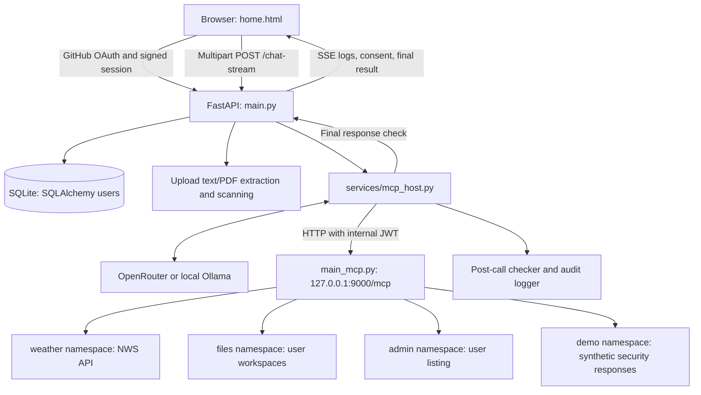

# Secure AI MCP Web Server — Local Version

This university MCP project explores how an AI web application can use local files and online tools while applying explicit security checks. The emphasis is security experimentation: controlling tool selection, arguments, uploaded content, tool results, and final model responses rather than building an unrestricted assistant.

[local_mcp](https://github.com/LiBingze33/ICP-Project1/tree/local_mcp) is the advanced locally hosted version. Its application implementation is also presented on [main](https://github.com/LiBingze33/ICP-Project1/tree/main); `main` excludes the runtime database and committed user workspace files and has a different README. The [original university implementation](https://github.com/LiBingze33/ICP-Project1/tree/terminal_required) remains available separately. The [public version](https://github.com/LiBingze33/ICP-Project1/tree/domain_mcp) targets [https://9163.syslab.au](https://9163.syslab.au).

## System architecture



GitHub login creates or retrieves a SQLAlchemy user and a workspace folder. Before chat processing, FastAPI reloads the user from the database and builds the role/workspace context. The MCP host classifies requests as general, files, weather, admin, or demo, selects a prompt and tool policy, filters tools by role, validates calls, and injects the trusted workspace into file arguments. A tool result is scanned before the follow-up model call; the final answer is scanned again.

The parent MCP server mounts four child servers within one process. It is a single internal HTTP endpoint, not four separately launched services. The web application streams progress events and a final response; this is not token-by-token model streaming.

## Implemented features

- GitHub OAuth login/logout, signed sessions, database-backed users, and default `user` roles.
- File listing, UTF-8 reading, creation, and deletion within user workspace folders. Deletion pauses for the browser's consent workflow.
- US weather alerts and coordinate-based forecasts through `api.weather.gov`.
- Admin user listing, exposed by the host only for database users with the `admin` role. There is no role-management UI or automatic admin enrolment.
- OpenRouter and Ollama selection in the browser; defaults are `anthropic/claude-sonnet-4.5` and `llama3.2` respectively.
- Uploads of `.txt`, `.md`, `.pdf`, `.png`, `.jpg`, and `.jpeg`. Text is UTF-8 decoded; PDFs use `pypdf`, with a `PyPDF2` fallback. Extracted PDF text is capped at 20,000 characters. Images require a model with vision support.
- Security demo tools: `demo_safe_health_check`, `demo_safe_public_info`, `demo_safe_echo`, `demo_fake_secret_api`, `demo_fake_desktop_info_api`, and `demo_fake_error_status_api`. Harmful-looking responses are synthetic demonstrations, not reads of real credentials or Desktop files.

## Security architecture and boundaries

| Layer | Implemented control and purpose |
| --- | --- |
| Browser session | Signed cookie with `SameSite=Lax`, `Secure`, and a two-hour lifetime; chat requires a logged-in session |
| Trusted identity | Role and workspace are reloaded from SQLite rather than accepted from submitted chat fields |
| Host policy | Category allowlists, role filtering, argument validation, trusted workspace injection, and per-file delete consent |
| Internal MCP access | HS256 JWTs expire after 60 seconds; middleware validates signature, issuer `fastapi-web`, and audience `mcp-server` |
| MCP resource limits | Parent middleware configures five requests/second, burst capacity ten, and a 100,000-byte response limit |
| Active pre-call checks | Host/upload code calls `reject_unsafe_text` for XSS/SQL-like input; file tools reject path separators and `..` and restrict workspace roots |
| Post-call checks | URL/HTML decoding, whitespace normalisation, compact structural XSS checks, secret/prompt-injection/API-status/Desktop-leak patterns, and local-path redaction |
| Audit records | JSON lines in `security/post_call_audit.log`, including time, identity, role, tool, status, duration, output size, decision, and reason; selected sensitive field names are redacted |

The full `PreCheckMiddleware` class also contains sensitive-filename, operation-permission, read-result, and `confirm=True` rules. It is **not registered** on the parent or file server in this branch. Its presence must not be confused with active middleware enforcement; the host's helper checks and consent workflow are the connected controls.

Internal JWT verification authenticates the calling service; it does not itself enforce per-tool roles. The host implements role filtering. The registered `weather_only_tool` is outside the host allowlists. `weather_get_user_info` expects FastMCP access-token claims, whereas the custom JWT middleware only verifies a token and does not populate that context; this tool should not be described as a verified working identity endpoint.

## Project structure

```text
.gitignore
README.md
web_server/
  Makefile                         # Dependency installation and startup targets
  main.py                          # OAuth, sessions, database lookup, uploads, SSE
  main_mcp.py                      # Parent server, namespaces, JWT and limits
  database/
    db.py                          # Relative SQLite connection/session factory
    model.py                       # User identity, email, role, workspace fields
  mcp_servers/
    weather_http_server.py
    local_file_server.py
    admin_server.py
    demo_security_server.py
  middleware/
    __init__.py
    internal_jwt.py
    pre_check.py
    response_check.py
  services/
    mcp_host.py                     # Models, policy, calls, consent and scanning
    upload_processing.py           # Decoding, PDF extraction, upload prompts
  security/post_call_audit.py
  pages/home.html                  # Login, model selection, upload and chat UI
  database.db                      # Existing tracked runtime data
  user_workspaces/                  # Existing tracked user files; not sample config
```

`security/post_call_audit.log` is generated at runtime and ignored. No `tests/` directory, dependency lockfile, reverse-proxy configuration, container manifest, or service definition is included in this branch.

## Installation and local setup

Prerequisites: Python 3.10+ for the source syntax, pip/venv, Make, GitHub OAuth application credentials, an OpenRouter API key, and network access to GitHub's OAuth/API endpoints and the selected external services. The branch does not pin Python or dependency versions. Commands below describe the existing entry points, not a newly tested installation.

```bash
git clone --branch local_mcp https://github.com/LiBingze33/ICP-Project1.git
cd ICP-Project1/web_server
make install
```

`make install` creates `venv` and installs FastAPI, Uvicorn, Jinja2, Pydantic, python-dotenv, OpenAI, FastMCP, HTTPX, SQLAlchemy, Authlib, itsdangerous, PyJWT, pypdf, and python-multipart. Keep both processes in `web_server`: SQLite, templates, and workspace paths depend on that working directory.

Set the following variables securely in the environment or an untracked `web_server/.env`. Do not paste credentials into documentation:

| Variable | Use |
| --- | --- |
| `GITHUB_CLIENT_ID`, `GITHUB_CLIENT_SECRET` | OAuth application credentials |
| `SESSION_SECRET_KEY` | Strong private session-signing key |
| `INTERNAL_JWT_SECRET` | Strong shared private key for the web and MCP processes |
| `OPENROUTER_API_KEY` | Required by the OpenRouter client created at import time, even when selecting Ollama later |
| `OPENROUTER_MODEL` | Optional; defaults to `anthropic/claude-sonnet-4.5` |
| `OLLAMA_BASE_URL` | Optional; defaults to `http://127.0.0.1:11434/v1` |
| `OLLAMA_MODEL` | Optional; defaults to `llama3.2` |

`make session-key` prints a newly generated random value; generate and store separate private session/JWT keys. SQLAlchemy creates the user table on web startup if absent. Existing tracked database/workspace files are historical runtime data, not required initialisation fixtures. Do not reuse their user records as your own configuration.

Start MCP in one terminal:

```bash
cd ICP-Project1/web_server
make mcp
```

The existing development target in another terminal is `make web`, which serves plain HTTP on `0.0.0.0:8000` with reload. **The session cookie is always Secure**, so plain HTTP is not a reliable authenticated workflow. For local authenticated use, provide a locally trusted certificate/key and start Uvicorn with its TLS options instead:

```bash
venv/bin/uvicorn main:app --host 127.0.0.1 --port 8000 \
  --ssl-certfile /path/to/trusted-local.crt --ssl-keyfile /path/to/private-local.key
```

Register the matching HTTPS origin and `/auth/callback` URL in your GitHub OAuth app, for example `https://127.0.0.1:8000/auth/callback` when using that trusted certificate/origin. The local branch computes its callback from the incoming request URL. Certificate provisioning is outside the repository. These runtime options preserve the application configuration. The MCP listener remains on loopback port 9000.

Ollama is optional. To select it, run an Ollama service at the configured URL and make the selected model available there; image requests also need vision support. Neither Ollama installation nor model provisioning is automated by the Makefile.

## Usage and security demonstrations

Open your configured local HTTPS URL, log in with GitHub, choose a model backend, and submit a message. The browser displays progress logs, consent prompts, and the final answer.

- Ask “Create a file named notes.txt with content hello world”, then “Read notes.txt”.
- Ask to delete `notes.txt`; confirm or cancel in the browser.
- Upload a normal text/PDF document and request a summary, or upload an image and request a description.
- Ask to read `../../secret.txt` to demonstrate path rejection, or request an XSS-like file payload to exercise input detection.
- Ask “Run the security demo safe health check” for a benign tool response; the fake secret, Desktop, and error-status tools demonstrate post-call blocking.

These are manual demonstration scenarios, not reported passing tests. Model classification and external model availability affect execution. Only use synthetic test content and non-sensitive uploads.

## Limitations and data handling

This is an educational security prototype, not production-ready security software. Pattern checks can miss attacks or reject legitimate text. Images reach the selected model before their descriptions are scanned; there is no pre-model OCR or malware scanner. Uploaded files are read into memory and the code does not impose an overall upload-size limit. OpenRouter receives submitted prompts, supported image content, and allowed tool output when selected. Ollama avoids that model-service transfer but GitHub OAuth and weather still use external services.

Audit redaction is based on selected dictionary keys, not a guarantee that arbitrary strings are secret-free. Development debug output includes model content and tool arguments; do not treat console logs as sanitised audit logs. JWT service authentication and host allowlists do not constitute complete independent server-side authorisation.

The current `.gitignore` covers `.env`, environments, bytecode, and security logs, but does **not** exclude the tracked database or user workspaces. Avoid broad staging of runtime data. Keep credentials, databases, workspace uploads, and logs private. Existing tracked data is retained on this branch under the documentation-only scope; it is excluded from the new `main` tree, but historical commits still contain it.

Further work discussed in the original documentation includes OCR before image submission, stricter file validation, malware scanning, formal threat modelling, fuzzing, monitoring, and deployment secret management. No automated test files are included in this branch, and no runtime validation was performed for this documentation update.

## Other versions

- [main](https://github.com/LiBingze33/ICP-Project1/tree/main): portfolio presentation of this application, with runtime data excluded.
- [terminal_required](https://github.com/LiBingze33/ICP-Project1/tree/terminal_required): original terminal client and basic web demo, without this authentication/security workflow.
- [domain_mcp](https://github.com/LiBingze33/ICP-Project1/tree/domain_mcp): largely the same advanced application, with a fixed public OAuth callback. Its hosting/TLS configuration is not checked in. Public service availability is not verified here.
