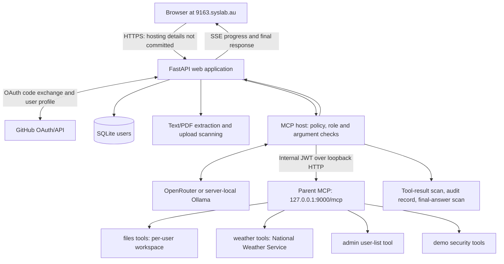

# Secure AI MCP Web Server — Public Domain Version

[domain_mcp](https://github.com/LiBingze33/ICP-Project1/tree/domain_mcp) is the publicly deployed version of this university security-focused MCP prototype. The supplied deployment address is **[https://9163.syslab.au](https://9163.syslab.au)**. This documentation describes the committed implementation; it does not establish that the service is currently online.

The project demonstrates controlled interaction between an AI model, local files, external weather APIs, and MCP tools. Authentication, tool policies, pre-call validation, post-call scanning, and audit records provide material for security demonstrations and the university project report.

## Application architecture



The browser submits multipart forms to `/chat-stream`. FastAPI checks the signed session and reloads the user's database record before constructing trusted identity, role, and workspace context. The host selects a request category and MCP prompt, exposes only its allowed tools, executes validated calls, scans tool results, and checks the final model answer. The MCP children are mounted namespaces in one parent server process, not independent network services.

## Public deployment and authentication

`main.py` explicitly sets the OAuth redirect URI to `https://9163.syslab.au/auth/callback`. `/auth/callback` exchanges the GitHub authorisation code, retrieves the GitHub profile, creates or loads the SQLite user, establishes their workspace, and stores identity in the signed session. New users receive role `user`; there is no admin registration or role-editing interface. Logout clears the application session, not the user's GitHub login.

The session cookie uses `Secure`, `SameSite=Lax`, and a two-hour lifetime. `make web` starts Uvicorn on `0.0.0.0:8000` with development reload. The MCP process binds only `127.0.0.1:9000`; the host's MCP URL is fixed to the same loopback address.

The application is configured for the public HTTPS address and callback. TLS, reverse-proxy routing, and process supervision are managed outside this repository.

## Implemented features

- GitHub OAuth login, signed sessions, SQLAlchemy/SQLite users, and per-user workspace folders.
- Category-specific tool allowlists for files, weather, admin, demo, and general conversation. General conversation has no tools.
- File list/read/create/delete operations, with host-supplied workspace arguments and a browser consent/resubmission flow for deletion.
- US weather alerts and location forecasts from `api.weather.gov`.
- Admin user listing filtered by the host according to the database role.
- Browser selection of OpenRouter or Ollama; model progress logs and final replies are delivered with SSE, not individual streamed model tokens.
- UTF-8 text/Markdown and PDF summarisation, plus image descriptions for `.png`, `.jpg`, and `.jpeg` using a vision-capable backend. PDF extraction is limited to 20,000 characters.
- Six synthetic security tools: `demo_safe_health_check`, `demo_safe_public_info`, `demo_safe_echo`, `demo_fake_secret_api`, `demo_fake_desktop_info_api`, and `demo_fake_error_status_api`.

The demo tools use synthetic responses to demonstrate output scanning without reading real secrets or Desktop files.

## Security mechanisms

| Layer | Connected implementation |
| --- | --- |
| User context | Chat requires a session and a database user; role/workspace are reloaded from SQLite |
| Tool selection | Host category allowlists, admin filtering, argument validation, and trusted workspace injection |
| Consent | A delete action key identifies the filename; the browser asks before resubmitting an approved operation |
| Service authentication | HS256 internal JWT, 60-second expiry, issuer `fastapi-web`, audience `mcp-server` |
| MCP limits | Five requests/second, burst ten, response limit 100,000 bytes |
| Input | Active XSS/SQL-like pattern checks in host/upload paths; file tools reject separators and parent-traversal filename forms |
| Output | Secret/prompt-injection/XSS/API-error/Desktop-leak patterns; URL/HTML canonicalisation and local-path redaction |
| Audit | JSON-lines tool decisions with identity, role, duration, output size and reason; selected secret/content/workspace keys are redacted |

Input validation runs through shared helpers in the host and upload flows. The standalone pre-check middleware is not registered on the MCP servers. Internal JWTs authenticate the backend service, while the host applies role-based tool policies.

The post-call checker scans tool output before the follow-up model call and checks the final answer before display. Upload text/PDF content is scanned before model submission, and audit records capture tool execution decisions.

## Differences from the local version

| Topic | `local_mcp` | `domain_mcp` |
| --- | --- | --- |
| Intended access | Developer-hosted browser session | Public HTTPS address above |
| OAuth callback | Derived from incoming request URL | Fixed to the public domain callback |
| Secure session cookie | Enabled | Enabled; not an additional public-only feature |
| Web/MCP defaults | Uvicorn :8000 and loopback MCP :9000 | Same defaults |
| Data/model/security workflow | OAuth, SQLite, allowlists, JWTs, uploads, post-call checks | Same functional workflow |
| Deployment infrastructure | Not committed | Also not committed |
| Repository presentation | More explanatory source comments | Different source comments/formatting and an additional security demonstration resource |

Both versions use the same core security workflow. Runtime databases and user workspaces are ignored by Git in both branches.

## Project structure

```text
.gitignore
README.md
web_server/
  Makefile
  main.py                          # Fixed public OAuth callback, sessions, SSE
  main_mcp.py                      # Parent MCP and middleware
  database/
    db.py                          # sqlite:///./database.db
    model.py                       # User record
  mcp_servers/
    admin_server.py
    demo_security_server.py
    local_file_server.py
    weather_http_server.py
    secrets/                       # Existing demonstration path, not credentials setup
  middleware/
    __init__.py
    internal_jwt.py
    pre_check.py
    response_check.py
  pages/home.html
  security/post_call_audit.py
  services/
    mcp_host.py
    upload_processing.py
  database.db                      # Generated at runtime; ignored by Git
  user_workspaces/                  # Per-user runtime files; ignored by Git
```

## Installation and deployment prerequisites

Use Python 3.10+ for the source syntax, pip/venv, and Make. Dependencies are unpinned. The existing Makefile installs FastAPI, Uvicorn, Jinja2, Pydantic, python-dotenv, OpenAI, FastMCP, HTTPX, SQLAlchemy, Authlib, itsdangerous, PyJWT, pypdf, and python-multipart. PDF extraction falls back to PyPDF2 if separately available.

```bash
git clone --branch domain_mcp https://github.com/LiBingze33/ICP-Project1.git
cd ICP-Project1/web_server
make install
```

Supply credentials privately through the process environment or an untracked `web_server/.env`:

| Variable | Purpose/default |
| --- | --- |
| `GITHUB_CLIENT_ID`, `GITHUB_CLIENT_SECRET` | GitHub OAuth app registered for `https://9163.syslab.au/auth/callback` |
| `SESSION_SECRET_KEY` | Strong private cookie-signing key |
| `INTERNAL_JWT_SECRET` | Strong shared private key for web and MCP processes |
| `OPENROUTER_API_KEY` | Required when the client is created, even if Ollama is later selected |
| `OPENROUTER_MODEL` | Optional; `anthropic/claude-sonnet-4.5` |
| `OLLAMA_BASE_URL` | Optional; `http://127.0.0.1:11434/v1` on the deployment host |
| `OLLAMA_MODEL` | Optional; `llama3.2` |

`make session-key` generates a random value locally; use separate private session/JWT keys. Run both processes from `web_server`, since database, templates, and workspaces use relative paths:

```bash
make mcp
```

```bash
# In a second terminal in web_server:
make web
```

These commands start the development services. SQLAlchemy creates the user table if absent, and login creates each user's workspace. Public hosting additionally requires HTTPS access, the configured domain/callback, routing that supports streaming responses, and process supervision. Keep the MCP endpoint internal; hosting-specific configuration is managed separately.

Opening plain `http://127.0.0.1:8000` is useful for inspecting the page but does not reproduce public login: the callback remains the public URL and the cookie requires HTTPS. Use [local_mcp](https://github.com/LiBingze33/ICP-Project1/tree/local_mcp) for the local workflow. Ollama is an optional separately provisioned service/model on the deployment host; the browser user's machine does not host it for this public application.

## Access and usage

If the service is available, open [https://9163.syslab.au](https://9163.syslab.au), log in with GitHub, select a backend, and submit a message or upload. Try creating/reading `notes.txt`, asking for a US weather forecast with coordinates, summarising a non-sensitive PDF, or running the security demo safe health check. Deletion prompts for consent. Synthetic secret/Desktop/error-status demos exercise post-call checks using demonstration data.

## Security Scope & Future Improvements

This university prototype demonstrates host policies, service authentication, input validation helpers, output scanning, and tool audit logging in a publicly accessible workflow. The public version shares these controls with the local implementation.

Future work includes full pre-check middleware integration, automated security tests, stronger upload validation and size limits, OCR before image submission, and deployment monitoring. Images are currently checked through their model-generated descriptions. Use non-sensitive demonstration content, particularly with OpenRouter, and keep credentials private. Runtime databases, user workspaces, and audit logs are ignored by Git.

## Other project versions

- [main](https://github.com/LiBingze33/ICP-Project1/tree/main): primary portfolio presentation, based on the local implementation without runtime data.
- [local_mcp](https://github.com/LiBingze33/ICP-Project1/tree/local_mcp): advanced locally hosted implementation with a request-derived callback.
- [terminal_required](https://github.com/LiBingze33/ICP-Project1/tree/terminal_required): preserved original university terminal/basic-web implementation.
