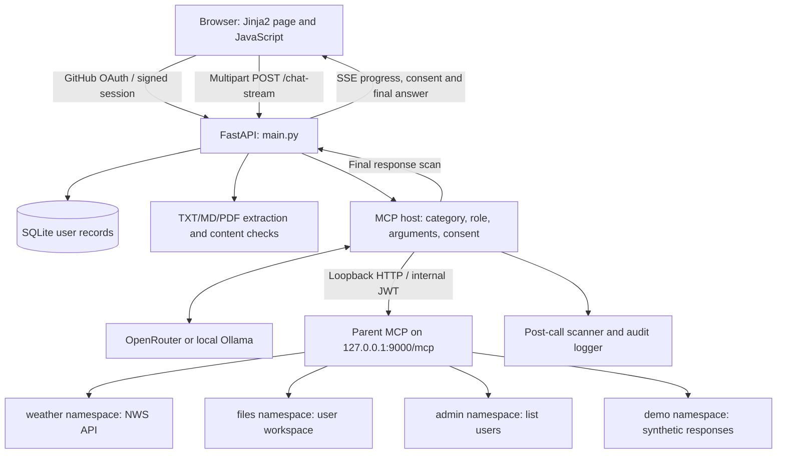

# Secure AI System with Model Context Protocol

A university project investigating how an AI assistant can use files and external tools through the **Model Context Protocol (MCP)** while applying explicit security controls. The application combines a FastAPI chat interface, GitHub login, database-backed user context, MCP tool policies, and checks around uploaded content, tool results, and final model answers.

The focus is security experimentation and explainable tool execution. This is an educational prototype, not a claim of production-grade attack prevention. This primary branch presents the advanced local implementation; the complete development progression is retained in separate branches.

## Project background and evolution

The project began with an interactive terminal weather client and a basic web demonstration for the original university assignment. That implementation remains on `terminal_required`, preserving the original `main` history and source. The assignment brief is not committed, so its exact assessment requirements are not inferred here.

The advanced implementation adds GitHub authentication, SQLAlchemy users, per-user workspaces, role-aware policies, service JWTs, upload processing, post-call checks, and audit records. `domain_mcp` adapts the application for the public OAuth callback at `https://9163.syslab.au`. Existing technical explanations about canonicalisation, safe synthetic demos, and prototype limitations are retained and clarified below.

## Available project versions

| Branch | Role | Access and execution |
| --- | --- | --- |
| [main](https://github.com/LiBingze33/ICP-Project1/tree/main) | Primary portfolio presentation of the advanced local implementation | Start the web and parent MCP services locally |
| [terminal_required](https://github.com/LiBingze33/ICP-Project1/tree/terminal_required) | Original basic university implementation | Terminal/stdin interaction with a stdio MCP subprocess; also contains a basic HTTP web demo |
| [local_mcp](https://github.com/LiBingze33/ICP-Project1/tree/local_mcp) | Advanced locally hosted system | Browser, GitHub OAuth, local web process and parent MCP process |
| [domain_mcp](https://github.com/LiBingze33/ICP-Project1/tree/domain_mcp) | Advanced public deployment version | Browser access at [9163.syslab.au](https://9163.syslab.au), when available |

`main` copies the application code, dependency declarations, and application layout of `local_mcp`. Intentional differences are this README and exclusion of `web_server/database.db` and all tracked `web_server/user_workspaces/` files. Those are runtime user data, not application source. History is preserved, so their exclusion from the latest tree does not erase earlier commits or copies on other branches.

## System architecture



1. GitHub OAuth identifies a user; SQLite stores their login, role, and workspace folder. A new user receives the `user` role.
2. Each chat request reloads that database record and builds trusted context. Submitted chat fields do not set the role or workspace.
3. The host classifies the request as general, files, weather, admin, or demo. It selects a prompt and tool allowlist and filters admin tools by role.
4. The selected model proposes tool calls. The host validates names/arguments, supplies the database-derived file workspace, and pauses deletion for browser consent.
5. The host connects to one parent MCP service using a short-lived internal JWT. Four mounted child servers provide namespaced tools in that process.
6. Tool results are scanned and audited before the follow-up model call. A final output scan runs before the browser receives the answer.

Uploaded text/PDF content is decoded or extracted and scanned before model submission. Images are sent to a vision-capable model and their descriptions are scanned afterward. SSE carries progress events and the final answer, not individual model tokens.

## Key features

- **Authenticated web workflow:** GitHub login/logout, signed sessions, SQLite users, and private workspace folders.
- **File tools:** list, read, create, and delete files using host-injected workspace context; deletion prompts for consent.
- **Weather tools:** US state alerts and coordinate forecasts through the National Weather Service API.
- **Role-aware administration:** the host exposes user listing to users whose database role is `admin`; there is no administrative role-editing UI.
- **Two model backends:** OpenRouter and Ollama, selected in the browser. Defaults are `anthropic/claude-sonnet-4.5` and `llama3.2`; backend/model capabilities still determine tool and vision support.
- **Uploads:** UTF-8 `.txt`/`.md`, PDF text extraction up to 20,000 characters, and `.png`/`.jpg`/`.jpeg` image description.
- **Security demonstrations:** synthetic safe/secret/Desktop/error-status tool outputs exercise checks without reading real secrets or Desktop files.
- **Audit trail:** JSON-lines records of tool execution outcomes and output-security decisions.

## Security design

| Boundary | Code and purpose |
| --- | --- |
| User identity | `main.py` implements OAuth, signed Secure cookies with `SameSite=Lax` and a two-hour lifetime, and database validation before chat |
| Tool permissions | `services/mcp_host.py` applies category allowlists, role filtering, weather/file argument checks, workspace injection, and delete consent |
| Internal transport | `middleware/internal_jwt.py` validates HS256 JWTs with issuer/audience checks; host tokens expire after 60 seconds |
| Service resource limits | `main_mcp.py` configures five requests/second, burst ten, and a 100,000-byte response limit |
| Input checks | Connected host/upload calls to `PreCheckMiddleware.reject_unsafe_text` detect XSS/SQL-like input; file tools reject separators and parent-traversal filename forms |
| Output checks | `middleware/response_check.py` canonicalises URL/HTML-encoded forms, normalises whitespace, checks compact XSS structures and secret/injection/error-status/Desktop patterns, and redacts local paths |
| Audit | `security/post_call_audit.py` records tool, identity, role, duration, status, output size, decision and reason; selected sensitive field names are redacted |

The full `PreCheckMiddleware` class contains additional sensitive-filename, permission, and read-output rules, but is **not mounted** on the MCP servers. Its helper calls are active; the whole middleware pipeline must not be claimed as enabled. Internal JWT checks authenticate the service and do not independently enforce per-tool role authorisation. Host role filtering is the implemented role boundary.

The registered `weather_only_tool` is not in the host's tool policies. `weather_get_user_info` expects FastMCP access-token claims that custom JWT verification does not populate; a working identity lookup through that tool is unverified. These qualifications correct broader claims in earlier documentation without changing code.

Pattern detectors are demonstration controls, not a complete defence against injection or data leakage. Images have no OCR scan before submission; no malware scanner or overall upload-size limit is implemented. Development console logs contain model/tool details and should not be considered sanitised. Audit redaction covers selected keys rather than all possible sensitive strings.

## Technology stack

| Area | Technologies used |
| --- | --- |
| Language and browser | Python, HTML, CSS, JavaScript, multipart forms, streamed SSE responses |
| Web | FastAPI, Uvicorn, Jinja2, Pydantic, Starlette sessions |
| MCP and models | FastMCP, MCP types, OpenAI-compatible client, OpenRouter, optional Ollama |
| Identity and data | Authlib GitHub OAuth, itsdangerous, SQLAlchemy, SQLite, PyJWT |
| I/O and processing | HTTPX, python-dotenv, python-multipart, pypdf; optional PyPDF2 fallback |
| Workflow | Make targets, pip and venv; no advanced-branch dependency lock or deployment automation |

## Project structure

```text
.gitignore
README.md
web_server/
  Makefile
  main.py                          # OAuth, user lookup, uploads and chat SSE
  main_mcp.py                      # Parent server and internal middleware
  database/
    db.py                          # SQLite connection and session factory
    model.py                       # User model
  mcp_servers/
    admin_server.py
    demo_security_server.py
    local_file_server.py
    weather_http_server.py
  middleware/
    __init__.py
    internal_jwt.py
    pre_check.py
    response_check.py
  pages/home.html                  # Login, backend selection, uploads and chat
  security/post_call_audit.py
  services/
    mcp_host.py                     # Policy and model/tool orchestration
    upload_processing.py           # Text/PDF extraction and prompts
```

Runtime creates `web_server/database.db`, `web_server/user_workspaces/`, and `web_server/security/post_call_audit.log`. Runtime user data is intentionally absent from this branch's committed tree. The database is created on web startup and user workspace folders on login. There is no `tests/` directory in this implementation.

## Installation and local setup

Prerequisites: Python 3.10+ for the source syntax, pip/venv, Make, a GitHub OAuth application, and an OpenRouter API key. Dependencies and Python are not pinned in this branch. Ollama is an optional separate service. These instructions follow the checked source and Makefile; this documentation update did not install or run the advanced application.

```bash
git clone https://github.com/LiBingze33/ICP-Project1.git
cd ICP-Project1/web_server
make install
```

The Makefile creates `venv` and installs the libraries listed above. Keep all startup commands in `web_server`: database, template, and workspace paths depend on the working directory.

Provide these variables securely through the process environment or an untracked `web_server/.env`:

| Variable | Requirement or default |
| --- | --- |
| `GITHUB_CLIENT_ID`, `GITHUB_CLIENT_SECRET` | Required OAuth app credentials |
| `SESSION_SECRET_KEY` | Required strong private session-signing key |
| `INTERNAL_JWT_SECRET` | Required strong shared key for web and MCP processes |
| `OPENROUTER_API_KEY` | Required by client construction, even if Ollama is selected later |
| `OPENROUTER_MODEL` | Optional; `anthropic/claude-sonnet-4.5` |
| `OLLAMA_BASE_URL` | Optional; `http://127.0.0.1:11434/v1` |
| `OLLAMA_MODEL` | Optional; `llama3.2` |

`make session-key` generates a random value locally; use separate private session/JWT keys. Do not commit values. For Ollama, separately run its service and provide the selected model; image use requires vision support. OpenRouter and weather also require outbound HTTPS, and OAuth calls GitHub's login and API endpoints.

Start MCP in one terminal:

```bash
make mcp
```

The repository's web target is `make web`: Uvicorn, port 8000, all interfaces, reload. It serves HTTP, while `SessionMiddleware` always sets a Secure cookie. For local login, use a trusted local HTTPS certificate/key with Uvicorn instead of relying on a plain-HTTP session:

```bash
venv/bin/uvicorn main:app --host 127.0.0.1 --port 8000 \
  --ssl-certfile /path/to/trusted-local.crt --ssl-keyfile /path/to/private-local.key
```

Register the matching HTTPS origin and `/auth/callback` in the GitHub OAuth app, such as `https://127.0.0.1:8000/auth/callback` if that is your certificate's origin. The local implementation derives the callback from the request URL. Certificate provisioning is not included in the repository. These are runtime options, not changes to the application's security configuration.

Open that local HTTPS URL, log in, and select a backend. Try creating and reading a non-sensitive `notes.txt`, deleting it through the consent prompt, requesting US weather with coordinates, or uploading a document for summarisation. The security demo health check is a benign example; synthetic secret/Desktop/error tools demonstrate intended blocking. These examples describe intended manual checks, not passing test results.

Keep `.env`, credentials, databases, workspace uploads, and logs out of commits. The inherited `.gitignore` ignores `.env`, environments, bytecode, and security logs, but does not ignore runtime databases/workspaces; review explicit staged paths carefully. Their exclusion from this commit is not an ongoing ignore rule.

## Public deployment

[domain_mcp](https://github.com/LiBingze33/ICP-Project1/tree/domain_mcp) targets **[https://9163.syslab.au](https://9163.syslab.au)**. Visitors use the hosted browser application and GitHub login without starting local services. If Ollama is selected there, it refers to the deployment server's model service, not the visitor's computer.

The verified public-specific application change is the fixed OAuth callback `https://9163.syslab.au/auth/callback`. Both advanced branches retain Secure cookies, the same web/MCP default ports, SQLite users, tool policies, and security pipeline. Source differences also include comments/line endings, an audit-module annotations import, and runtime data. Neither branch contains the actual TLS/reverse-proxy or hosting configuration; no specific infrastructure or stronger public-only protection is inferred. Service availability was not checked for this documentation update.

## Version comparison

| Capability | Original `terminal_required` | Advanced local (`local_mcp` / `main`) | Public `domain_mcp` |
| --- | --- | --- | --- |
| Interaction | Terminal client; separate basic web demo | Authenticated browser with SSE progress and consent | Same browser workflow through public HTTPS URL |
| MCP topology | stdio weather subprocess or separate HTTP weather/file servers | One parent HTTP server with four namespaced children | Same parent/child topology |
| Identity/data | Fixed demonstration identity/preferences; shared demo files | GitHub OAuth, SQLite users/roles, per-user workspaces | Same application data model |
| Model backend | OpenRouter | OpenRouter or Ollama | OpenRouter or server-local Ollama |
| Security scope | Basic allowlists and argument checks | Host policies, internal JWT, active input checks, output scanning and audits | Same implemented controls |
| Uploads | No summarisation workflow | TXT/MD/PDF summaries and supported image descriptions | Same upload workflow |
| Callback | No OAuth | Derived from request URL | Fixed public domain callback |
| Runtime data in latest tree | Original demonstration content preserved | Excluded on `main`; existing tracked data retained on `local_mcp` | Existing tracked runtime data retained |

The prior public README referenced automated tests absent from its branch. No automated test suite or production deployment specification is committed in the advanced versions. Remaining work includes stronger file validation, OCR before model submission, malware scanning, monitoring, formal threat modelling, fuzz testing, and deployment secret management. These are limitations and future directions, not implemented features.
